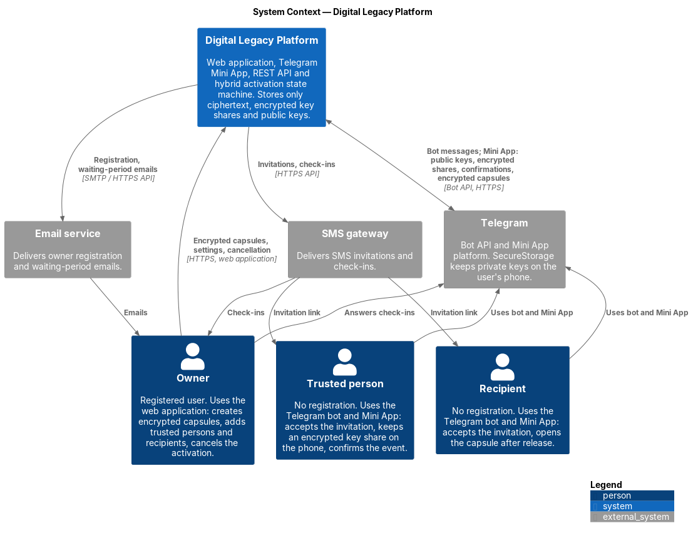
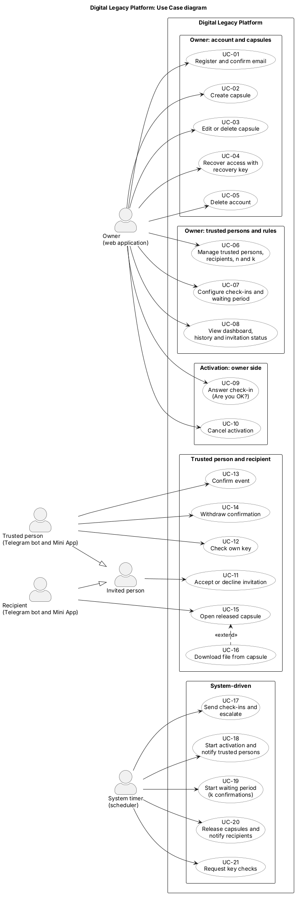

# 7. Architecture and Diagrams

| Section | Responsible |
|---|---|
| 7.1 System context | Alisher Medebaev (DIP-16) |
| 7.2 Use cases | Aibyn Samat (DIP-17) |
| 7.3 Components (draft), 7.4 Trust boundaries, 7.5 Activation state machine | Alisher Medebaev (DIP-18) |

## 7.1 System context

Source: [`diagrams/src/01-system-context.puml`](../diagrams/src/01-system-context.puml) (C4 model, level 1)

The diagram shows the Digital Legacy Platform as one system, the people who use it and the external services it depends on.

### People

| Actor | Interface | Interaction with the system | Related requirements |
|---|---|---|---|
| Owner | Web application (registered account) | Creates encrypted capsules, configures trusted persons, recipients, check-in interval and waiting period, answers check-ins, cancels the activation | FR-CRY-01…03, FR-ACT-01…05, FR-ACT-10 |
| Trusted person | Telegram bot and Mini App (no registration) | Accepts the invitation, generates a key pair on the phone, keeps an encrypted key share, confirms the event | FR-CRY-03a, FR-CRY-05, FR-CRY-06, FR-INV-01…05 |
| Recipient | Telegram bot and Mini App (no registration) | Accepts the invitation, generates a key pair on the phone, receives and decrypts the capsule after release | FR-CRY-03a, FR-CRY-07, FR-ACT-11, FR-INV-01…05 |

### External systems

| System | Purpose | Data exchanged | Related requirements |
|---|---|---|---|
| Telegram (Bot API, Mini App platform) | Invitations, check-ins, confirmation requests and notifications; runs the Mini App; SecureStorage keeps private keys on the user's phone | Bot messages; from the Mini App: public keys, encrypted shares, confirmations; to the Mini App: encrypted capsules and shares | FR-ACT-02, FR-INV-04, FR-CRY-03a, CON-01…04 |
| SMS gateway | SMS invitations with a link to the bot, check-ins | Invitation links, check-in messages | FR-INV-02, FR-ACT-02 |
| Email service | Owner registration and waiting-period notifications | Email messages | FR-ACT-09 |

### Key properties shown by the diagram

- The platform receives and stores only ciphertext, encrypted key shares and public keys (NFR-SEC-01). Private keys stay in the owner's browser (encrypted) or in Telegram SecureStorage on the phones of trusted persons and recipients.
- Trusted persons and recipients interact only through Telegram; a Telegram bot cannot write first, so the first contact is an SMS invitation (CON-01).
- Telegram, SMS and email carry only messages and links; they never receive keys or plaintext capsule content.

## 7.2 Use cases

Source: [`diagrams/src/02-use-cases.puml`](../diagrams/src/02-use-cases.puml) (UML use case diagram)

The diagram shows what each actor can do in the platform. The actors are the same as in the system context diagram (section 7.1); the system timer is added as the actor that drives the activation process.

### Actors

| Actor | Interface | Role in the diagram |
|---|---|---|
| Owner | Web application (registered account) | Prepares capsules and rules, answers check-ins, cancels activation |
| Trusted person | Telegram bot and Mini App | Confirms the event, keeps and checks a key share |
| Recipient | Telegram bot and Mini App | Receives and opens capsules after release |
| Invited person | Telegram bot and Mini App | Generalization of the trusted person and the recipient: both accept or decline an invitation in the same way |
| System timer | Scheduler (Quartz) | Starts check-ins, escalation, the waiting period and release by time; not a person |

### Use cases and requirements

| Use case | Actor | Main requirements |
|---|---|---|
| UC-01 Register and confirm email | Owner | FR-OWN-01, FR-CRY-02, FR-CRY-03, FR-CRY-09 |
| UC-02 Create capsule | Owner | FR-OWN-02, FR-OWN-03, FR-OWN-12, FR-CRY-01, FR-CRY-04, FR-CRY-05 |
| UC-03 Edit or delete capsule | Owner | FR-OWN-05, FR-CRY-01 |
| UC-04 Recover access with recovery key | Owner | FR-CRY-09 |
| UC-05 Delete account | Owner | FR-OWN-11 |
| UC-06 Manage trusted persons, recipients, *n* and *k* | Owner | FR-OWN-06, FR-ACT-04, FR-CRY-04, FR-CRY-05, FR-CRY-08, FR-INV-02, FR-INV-03, FR-INV-07 |
| UC-07 Configure check-ins and waiting period | Owner | FR-OWN-04, FR-OWN-07, FR-ACT-01, FR-ACT-02, FR-ACT-05, FR-NOT-10 |
| UC-08 View dashboard, history and invitation status | Owner | FR-OWN-08, FR-OWN-10, FR-ACT-13, FR-INV-07 |
| UC-09 Answer check-in ("Are you OK?") | Owner | FR-NOT-02, FR-NOT-03, FR-ACT-03 |
| UC-10 Cancel activation | Owner | FR-OWN-09, FR-ACT-10 |
| UC-11 Accept or decline invitation | Invited person | FR-INV-04, FR-INV-05, FR-INV-06, FR-TRU-01, FR-TRU-06, FR-CRY-03a |
| UC-12 Check own key | Trusted person | FR-TRU-07, FR-CRY-10 |
| UC-13 Confirm event | Trusted person | FR-TRU-03, FR-TRU-04, FR-ACT-08, FR-CRY-06 |
| UC-14 Withdraw confirmation | Trusted person | FR-TRU-05, FR-ACT-12 |
| UC-15 Open released capsule | Recipient | FR-TRU-08, FR-CRY-07, FR-ACT-11 |
| UC-16 Download file from capsule (extends UC-15) | Recipient | FR-TRU-09 |
| UC-17 Send check-ins and escalate | System timer | FR-ACT-02, FR-ACT-03, FR-ACT-07, FR-NOT-02, FR-NOT-03, FR-NOT-09 |
| UC-18 Start activation and notify trusted persons | System timer | FR-ACT-03, FR-ACT-06, FR-NOT-04 |
| UC-19 Start waiting period (*k* confirmations) | System timer | FR-ACT-06, FR-ACT-08, FR-ACT-09 |
| UC-20 Release capsules and notify recipients | System timer | FR-ACT-06, FR-ACT-11, FR-NOT-06 |
| UC-21 Request key checks | System timer | FR-CRY-10, FR-TRU-07, FR-NOT-05 |

### Notes

- The system timer triggers use cases that need no human action. A missed check-in only starts the process (UC-18); the data is never released without *k* confirmations (UC-13, UC-19) and the end of the waiting period (UC-20), see FR-ACT-07.
- Requirements that apply to many use cases are not repeated in the table: FR-TRU-02 and FR-TRU-10 (what a trusted person sees, help screens), FR-NOT-01, FR-NOT-07, FR-NOT-08 (notification catalogue, no sensitive data in messages, language), NFR-SEC, NFR-USE and NFR-L10N. FR-NOT-11 (WhatsApp) would only add a channel to UC-17 if accepted in section 5.7.
- The owner can cancel (UC-10) in every state before RELEASED.

## 7.3 Components (draft)

*To be added in DIP-18.*

## 7.4 Trust boundaries and data protection

*To be added in DIP-18.*

## 7.5 Activation state machine

*To be added in DIP-18.*
