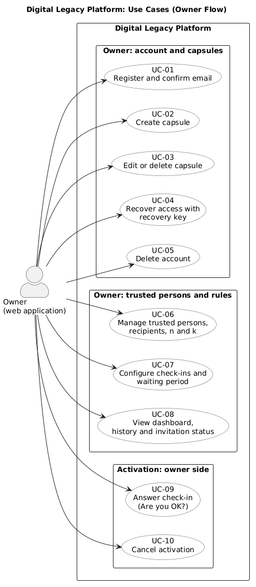
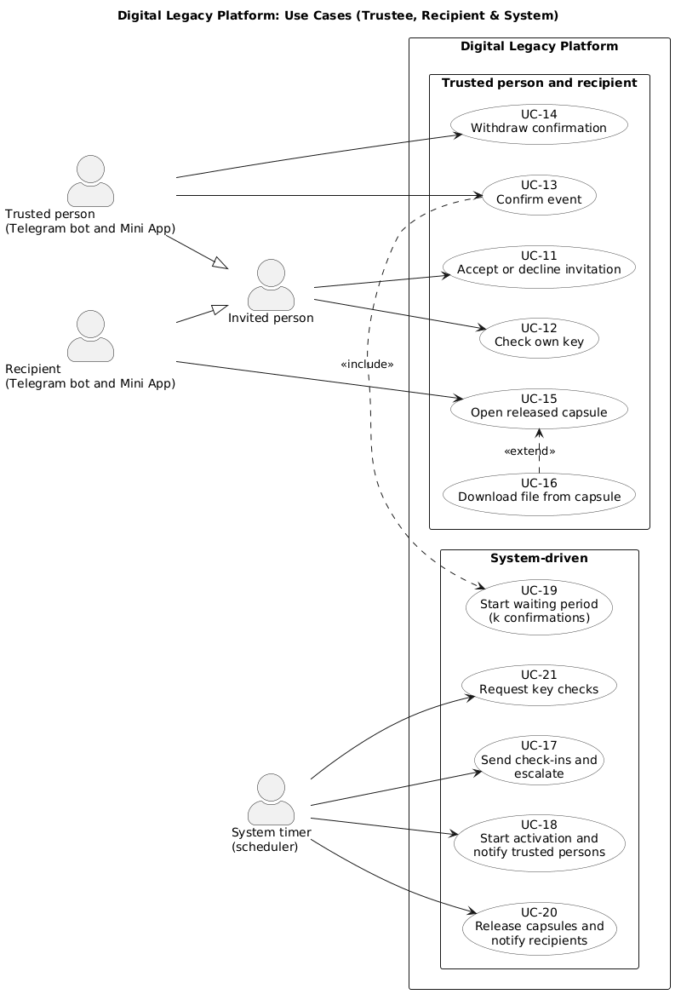
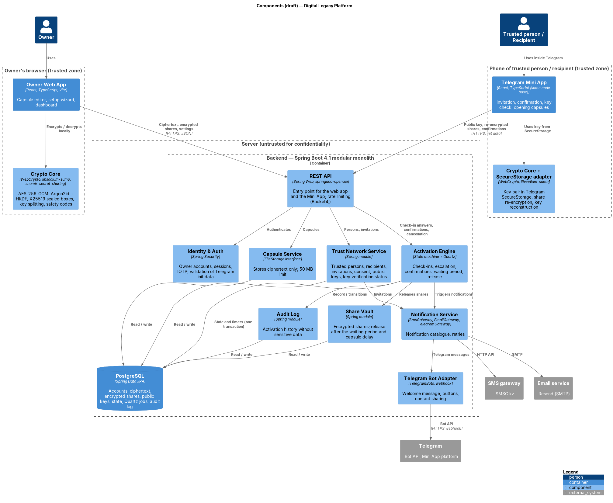
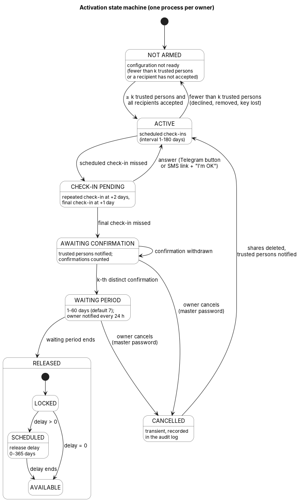

# 7. Architecture and Diagrams

| Section | Responsible |
|---|---|
| 7.1 System context | Alisher Medebaev (DIP-16) |
| 7.2 Use cases | Aibyn Samat (DIP-17) |
| 7.3 Components (draft), 7.4 Trust boundaries and data protection, 7.5 Activation state machine | Alisher Medebaev (DIP-18) |

## 7.1 System context

Source: [`diagrams/src/01-system-context.puml`](../diagrams/src/01-system-context.puml) (C4 model, level 1)

The diagram shows the Digital Legacy Platform as one system, the people who use it and the external services it depends on.

### People

| Actor | Interface | Interaction with the system | Related requirements |
|---|---|---|---|
| Owner | Web application (registered account) | Creates encrypted capsules, configures trusted persons, recipients, check-in interval and waiting period, answers check-ins, cancels the activation | FR-CRY-01…03, FR-ACT-01…05, FR-ACT-10 |
| Trusted person | Telegram bot and Mini App (no registration) | Accepts the invitation, generates a key pair on the phone, keeps an encrypted key share, confirms the event | FR-CRY-03a, FR-CRY-05, FR-CRY-06, FR-INV-01…05 |
| Recipient | Telegram bot and Mini App (no registration) | Accepts the invitation, generates a key pair on the phone, receives and decrypts the capsule after release | FR-CRY-03a, FR-CRY-07, FR-ACT-11, FR-INV-01…05 |

### External systems

| System | Purpose | Data exchanged | Related requirements |
|---|---|---|---|
| Telegram (Bot API, Mini App platform) | Invitations, check-ins, confirmation requests and notifications; runs the Mini App; SecureStorage keeps private keys on the user's phone | Bot messages; from the Mini App: public keys, encrypted shares, confirmations; to the Mini App: encrypted capsules and shares | FR-ACT-02, FR-INV-04, FR-CRY-03a, CON-01…04 |
| SMS gateway | SMS invitations with a link to the bot, check-ins | Invitation links, check-in messages | FR-INV-02, FR-ACT-02 |
| Email service | Owner registration and waiting-period notifications | Email messages | FR-ACT-09 |

### Key properties shown by the diagram

- The platform receives and stores only ciphertext, encrypted key shares and public keys (NFR-SEC-01). Private keys stay in the owner's browser (encrypted) or in Telegram SecureStorage on the phones of trusted persons and recipients.
- Trusted persons and recipients interact only through Telegram; a Telegram bot cannot write first, so the first contact is an SMS invitation (CON-01).
- Telegram, SMS and email carry only messages and links; they never receive keys or plaintext capsule content.

## 7.2 Use cases

Source: [`diagrams/src/02-use-cases-owner.puml`](../diagrams/src/02-use-cases-owner.puml) (UML use case diagram)

Source: [`diagrams/src/02-use-cases-system.puml`](../diagrams/src/02-use-cases-system.puml) (UML use case diagram)

The diagrams show what each actor can do in the platform. The actors are the same as in the system context diagram (section 7.1); the system timer is added as the actor that drives the activation process.

### Actors

| Actor | Interface | Role in the diagram |
|---|---|---|
| Owner | Web application (registered account) | Prepares capsules and rules, answers check-ins, cancels activation |
| Trusted person | Telegram bot and Mini App | Confirms the event, keeps and checks a key share |
| Recipient | Telegram bot and Mini App | Receives and opens capsules after release |
| Invited person | Telegram bot and Mini App | Generalization of the trusted person and the recipient: both accept or decline an invitation in the same way |
| System timer | Scheduler (Quartz) | Starts check-ins, escalation and release by time; the waiting period starts on the k-th distinct confirmation |

### Use cases and requirements

| Use case | Actor | Main requirements |
|---|---|---|
| UC-01 Register and confirm email | Owner | FR-OWN-01, FR-CRY-02, FR-CRY-03, FR-CRY-09 |
| UC-02 Create capsule | Owner | FR-OWN-02, FR-OWN-03, FR-OWN-04, FR-ACT-15, FR-OWN-12, FR-CRY-01, FR-CRY-04, FR-CRY-05 |
| UC-03 Edit or delete capsule | Owner | FR-OWN-05, FR-CRY-01 |
| UC-04 Recover access with recovery key | Owner | FR-CRY-09 |
| UC-05 Delete account | Owner | FR-OWN-11 |
| UC-06 Manage trusted persons, recipients, *n* and *k* | Owner | FR-OWN-06, FR-ACT-04, FR-CRY-04, FR-CRY-05, FR-CRY-08, FR-INV-02, FR-INV-03, FR-INV-07, FR-OWN-13 |
| UC-07 Configure check-ins and waiting period | Owner | FR-OWN-07, FR-ACT-01, FR-ACT-02, FR-ACT-05, FR-NOT-09, FR-NOT-10 |
| UC-08 View dashboard, history and invitation status | Owner | FR-OWN-08, FR-OWN-10, FR-ACT-13, FR-INV-07 |
| UC-09 Answer check-in ("Are you OK?") | Owner | FR-NOT-02, FR-NOT-03, FR-ACT-03, FR-ACT-16 |
| UC-10 Cancel activation | Owner | FR-OWN-09, FR-ACT-10 |
| UC-11 Accept or decline invitation | Invited person | FR-INV-04, FR-INV-05, FR-INV-06, FR-TRU-01, FR-TRU-06, FR-CRY-03a, FR-CRY-11 |
| UC-12 Check own key | Invited person (trusted person or recipient) | FR-TRU-07, FR-CRY-10 |
| UC-13 Confirm event | Trusted person | FR-TRU-03, FR-TRU-04, FR-ACT-08, FR-CRY-06 |
| UC-14 Withdraw confirmation | Trusted person | FR-TRU-05, FR-ACT-12 |
| UC-15 Open released capsule | Recipient | FR-TRU-08, FR-CRY-07, FR-ACT-11 |
| UC-16 Download file from capsule (extends UC-15) | Recipient | FR-TRU-09 |
| UC-17 Send check-ins and escalate | System timer | FR-ACT-02, FR-ACT-03, FR-ACT-07, FR-ACT-16, FR-NOT-02, FR-NOT-03, FR-NOT-09 |
| UC-18 Start activation and notify trusted persons | System timer | FR-ACT-03, FR-ACT-06, FR-NOT-04 |
| UC-19 Start waiting period (k confirmations) | Trusted person (via UC-13, on the k-th distinct confirmation) | FR-ACT-06, FR-ACT-08, FR-ACT-09 |
| UC-20 Release capsules and notify recipients | System timer | FR-ACT-06, FR-ACT-11, FR-ACT-15, FR-NOT-06 |
| UC-21 Request key checks | System timer | FR-CRY-10, FR-TRU-07, FR-NOT-05 |

### Notes

- The system timer triggers use cases that need no human action. A missed check-in only starts the process (UC-18); the data is never released without *k* confirmations (UC-13, UC-19) and the end of the waiting period (UC-20), see FR-ACT-07.
- Requirements that apply to many use cases are not repeated in the table: FR-TRU-02 and FR-TRU-10 (what a trusted person sees, help screens), FR-NOT-01, FR-NOT-07, FR-NOT-08 (notification catalogue, no sensitive data in messages, language), NFR-SEC, NFR-USE and NFR-L10N. FR-NOT-11 (WhatsApp) is not planned for this version.
- The owner can cancel (UC-10) in every state before RELEASED.

## 7.3 Components (draft)

Source: [`diagrams/src/03-components.puml`](../diagrams/src/03-components.puml) (C4 model, levels 2–3)

The backend is a **modular monolith** on Spring Boot 4.1 (section 5.1): one deployable application with modules separated by interfaces. For a team of two this keeps one deployment, one database transaction for a state change and its timer (section 5.4b), and still allows a module to be extracted later. The frontend is one React code base with two entry points: the owner web application and the Telegram Mini App (section 5.6).

| Zone | Component | Responsibility | Main requirements |
|---|---|---|---|
| Owner's browser | Owner Web App | Capsule editor, setup wizard, dashboard, settings | FR-OWN-01…13, NFR-USE-04 |
| Owner's browser | Crypto Core | AES-256-GCM, Argon2id + HKDF (encryption and authentication keys), X25519 sealed boxes, key splitting, safety codes | FR-CRY-01…05, FR-CRY-11, FR-CRY-12 |
| Phone of trusted person / recipient | Telegram Mini App | Invitation and consent, key check, confirmation, opening capsules | FR-INV-04…08, FR-TRU-01…10 |
| Phone of trusted person / recipient | Crypto Core + SecureStorage adapter | Key pair in SecureStorage, share re-encryption, key reconstruction | FR-CRY-03a, FR-CRY-06, FR-CRY-07, FR-CRY-10 |
| Server | REST API | Single entry point for both clients; per-endpoint rate limiting | NFR-SEC-04, NFR-SEC-05 |
| Server | Identity & Auth | Owner accounts and sessions, TOTP, validation of Telegram init data | FR-OWN-01, FR-CRY-12, NFR-SEC-06 |
| Server | Capsule Service | Stores and returns ciphertext through the `FileStorage` interface; 50 MB limit | FR-OWN-02…05, NFR-CAP-01 |
| Server | Trust Network Service | Trusted persons, recipients, invitations, consent, public keys, key verification status | FR-INV-01…08, FR-CRY-11, FR-OWN-06 |
| Server | Share Vault | Encrypted shares; release after the waiting period and the capsule delay | FR-CRY-05, FR-CRY-06, FR-ACT-11, FR-ACT-15 |
| Server | Activation Engine | State machine (section 7.5) and Quartz timers for check-ins, escalation, waiting period and release | FR-ACT-01…16, NFR-REL-01 |
| Server | Notification Service | Notification catalogue; `SmsGateway`, `EmailGateway`, `TelegramGateway`; retries | FR-NOT-01…10, NFR-REL-02 |
| Server | Telegram Bot Adapter | Webhook, welcome message, buttons, contact sharing | FR-INV-04, FR-INV-05, CON-01 |
| Server | Audit Log | History of transitions and notifications without sensitive data | FR-ACT-13, NFR-SEC-07 |
| Storage | PostgreSQL | All persistent data, including Quartz job tables | section 5.2 |

The draft will be refined when the implementation starts; module boundaries and names may change.

## 7.4 Trust boundaries and data protection

There are two trusted zones: the owner's browser and the phone of each trusted person or recipient. Everything else — the server, the database, Telegram, the SMS gateway and the email service — is **untrusted for confidentiality**: it may see metadata, but never plaintext or keys.

| Data | Where it is stored | Form | Requirements |
|---|---|---|---|
| Capsule content and files | PostgreSQL | Ciphertext only (AES-256-GCM) | FR-CRY-01, NFR-SEC-01 |
| Capsule key | Nowhere as a whole | *k* ≥ 2: Shamir shares, each sealed for one trusted person; *k* = 1: a sealed copy per trusted person | FR-CRY-04, FR-CRY-05 |
| Master password | Nowhere | Known only to the owner | FR-CRY-02 |
| Owner's authentication key | PostgreSQL | Slow hash only | FR-CRY-12 |
| Owner's private key | PostgreSQL | Encrypted with the key derived from the master password | FR-CRY-03 |
| Private key of a trusted person or recipient | Telegram SecureStorage on their phone | Never leaves the device | FR-CRY-03a |
| Public keys | PostgreSQL | Plain; authenticity checked with safety codes | FR-CRY-11 |
| Shares submitted on confirmation | PostgreSQL | Sealed for the recipient | FR-CRY-06 |
| Name and phone number of invited persons | PostgreSQL | Plain (needed for SMS); deleted after a decline or expiry | FR-INV-08, NFR-LAW-01 |
| Messages via Telegram, SMS, email | External providers | Owner's name and links only | FR-NOT-07 |

**What the server is trusted for.** The server cannot read capsules, but it is trusted for **availability and timing**: it runs the timers and decides when shares are released (waiting period, capsule delay). A compromised server alone still cannot decrypt anything; a compromised server colluding with a recipient could release shares to that recipient early. This, the substitution of public keys (mitigated by FR-CRY-11) and the suppression of activation by a person holding the owner's phone are recorded for the threat model (NFR-SEC-03).

## 7.5 Activation state machine

Source: [`diagrams/src/04-activation-state-machine.puml`](../diagrams/src/04-activation-state-machine.puml) (UML state machine)

There is one process per owner (FR-ACT-14). Every transition and the timer that belongs to it are changed in one database transaction (section 5.4b) and recorded in the audit log (FR-ACT-06, FR-ACT-13).

| From | Event | To | Effect | Requirements |
|---|---|---|---|---|
| NOT ARMED | At least *k* trusted persons and every recipient have accepted | ACTIVE | First check-in is scheduled | FR-INV-07 |
| ACTIVE | Fewer than *k* trusted persons remain (declined, removed, key lost) | NOT ARMED | Owner notified | FR-TRU-06, FR-CRY-10 |
| ACTIVE | Scheduled check-in missed | CHECK-IN PENDING | Repeated check-in at +2 days | FR-ACT-03 |
| CHECK-IN PENDING | Answer (Telegram button, or SMS link and "I'm OK") | ACTIVE | Next check-in scheduled | FR-ACT-03, FR-ACT-16 |
| CHECK-IN PENDING | Final check-in (day +3) missed | AWAITING CONFIRMATION | Trusted persons notified | FR-ACT-07, FR-NOT-04 |
| AWAITING CONFIRMATION | Confirmation or withdrawal by a trusted person | AWAITING CONFIRMATION | Count of distinct confirmations updated | FR-ACT-08, FR-ACT-12 |
| AWAITING CONFIRMATION | *k*-th distinct confirmation | WAITING PERIOD | Owner notified on all channels, then every 24 h | FR-ACT-08, FR-ACT-09 |
| AWAITING CONFIRMATION, WAITING PERIOD | Owner cancels with the master password | CANCELLED → ACTIVE | Submitted shares deleted, trusted persons notified | FR-ACT-10 |
| WAITING PERIOD | Waiting period ends | RELEASED | Each capsule enters LOCKED | FR-ACT-11 |

After RELEASED, each capsule follows its own release delay (FR-ACT-15): **LOCKED → AVAILABLE** when the delay is 0, otherwise **LOCKED → SCHEDULED → AVAILABLE**. A recipient is notified when a capsule becomes AVAILABLE (FR-NOT-06) and sees a SCHEDULED capsule only as unavailable until its date (FR-TRU-08).

Notification transition guards: [section 13](13-notification-reliability.md) applies in addition to the table. A check-in cannot be missed without confirmed transport; total check-in-channel failure holds ACTIVE/CHECK-IN PENDING with a persisted delivery-fault flag. WAITING PERIOD pauses when every permitted owner channel fails; recovery delivers a fresh notice and restarts the full waiting period (FR-NOT-13/14). Existing diagram transitions are conditional on those guards; the delivery fault is metadata, not an extra activation state.

Any transition not listed in the table is rejected. In particular, an SMS check-in link cannot leave WAITING PERIOD (FR-ACT-16), and missed check-ins can never lead to RELEASED without *k* confirmations (FR-ACT-07).
