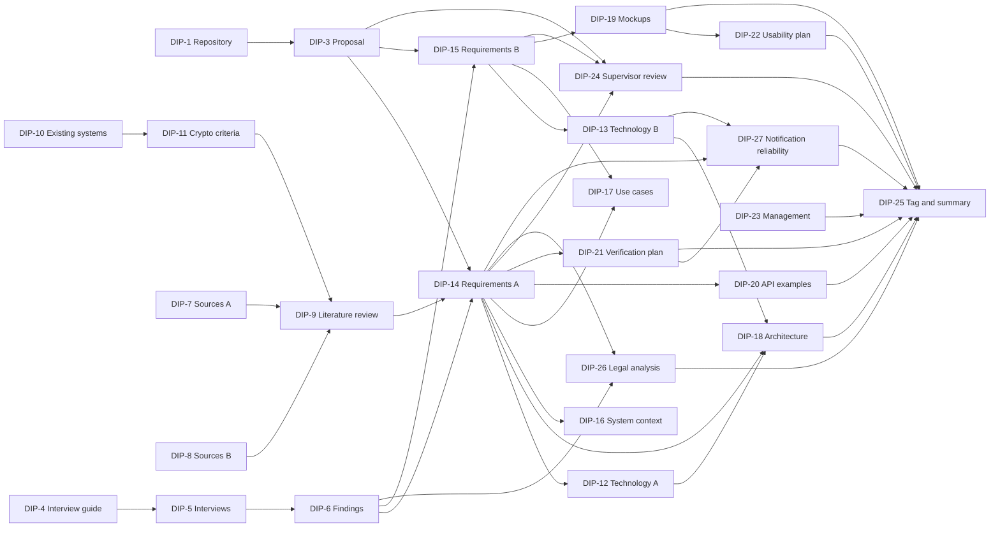

# 10. Project Management

Task: DIP-23. Responsible: Aibyn Samat. Status: done for pre-defense 1; updated on 24.10.2026 after the supervisor feedback (task register in section 10.1.1, tasks DIP-26 and DIP-27).

Dates marked `[TBD]` depend on the schedule of the department and the supervisor and are to be filled in as soon as they are confirmed.

## 10.1 Team and responsibilities

| Area | Alisher Medebaev | Aibyn Samat |
|---|---|---|
| Repository, YouTrack, tagging, submission | DIP-1, DIP-2, DIP-25 | Review of pull requests |
| Proposal and scope | DIP-3 (`01-proposal.md`) | Review |
| Evidence of relevance | Review | DIP-4, DIP-5, DIP-6 (`02-relevance-evidence/`) |
| Literature review | Review | DIP-7, DIP-8, DIP-9 (`03-literature-review.md`) |
| Existing systems | DIP-11: verification of cryptographic criteria | DIP-10 (`04-existing-systems.md`) |
| Technology comparison | DIP-12: backend, database, crypto libraries, interaction | DIP-13: frontend, notification services |
| Requirements | DIP-14: sections 6.1–6.4, 6.9 (encryption, key shares, activation, security) | DIP-15: sections 6.5–6.8 (cabinets, capsules, check-ins, notifications, usability, localization) |
| Diagrams | DIP-16 system context, DIP-18 component | DIP-17 use case |
| Architecture | DIP-18 (`07-architecture.md`) | Review |
| Prototype | DIP-20: API examples (section 8.2) | DIP-19: Figma mockups (section 8.1) |
| Verification | DIP-21: protocol, security, metrics, baseline | DIP-22: usability evaluation (section 9.5) |
| Project management | Review | DIP-23 (`10-project-management.md`) |
| Supervisor communication | DIP-24 (`11-supervisor-feedback.md`) | Takes part in meetings |
| Legal analysis (Kazakhstan) | Review | DIP-26 (`12-legal-analysis.md`, prepared 24.10.2026) |
| Notification reliability | Review; tests M6, M8, M12 (DIP-21) | DIP-27 (`13-notification-reliability.md` and section 6.7.1) |

Working rules:

- Every document change goes through a pull request. `main` requires one approval from the partner.
- Each task has one assignee in YouTrack; the other member is the reviewer.
- Tasks that depend on the partner's work (section 10.4) are discussed in the team chat before the due date, not on the due date.
- No secrets, interview recordings or personal data are committed.

### 10.1.1 Task register

Every task has one responsible member and one reviewer, the other member (working rules above). The milestone is taken from section 10.2; "PR" lists the pull requests that delivered the task.

| Task | Title | Responsible | Reviewer | Milestone | Status | PR |
|---|---|---|---|---|---|---|
| DIP-1 | Repository structure, README, PR template | Alisher | Aibyn | M1 | Done | #1, #23 |
| DIP-2 | YouTrack project, milestones and backlog | Alisher | Aibyn | M1 | Done | in YouTrack |
| DIP-3 | Project proposal and scope | Alisher | Aibyn | before M3 (22.10) | Done | #2 |
| DIP-4 | Interview guide and consent template | Aibyn | Alisher | M2 | Done | #6 |
| DIP-5 | User interviews | Aibyn | Alisher | M2 | Done | #7 |
| DIP-6 | Findings summary: verified findings and assumptions | Aibyn | Alisher | M2 | Done | #8 |
| DIP-7 | Literature review: sources, part A | Aibyn | Alisher | M2 | Done | #14 |
| DIP-8 | Literature review: sources, part B | Aibyn | Alisher | M2 | Done | #14 |
| DIP-9 | Critical literature review | Aibyn | Alisher | M4 | Done | #14 |
| DIP-10 | Existing systems comparison | Aibyn | Alisher | M2 | Done | #13 |
| DIP-11 | Verification of cryptographic criteria of existing systems | Alisher | Aibyn | M2 | Done | #19, #25 |
| DIP-12 | Technology comparison: backend, storage, crypto libraries | Alisher | Aibyn | M3 | Done | #4 |
| DIP-13 | Technology comparison: frontend, notification services | Aibyn | Alisher | M3 | Done | #12 |
| DIP-14 | Requirements: sections 6.1–6.4, 6.9 | Alisher | Aibyn | M3 | Done | #3, #11, #18, #25 |
| DIP-15 | Requirements: sections 6.5–6.8 | Aibyn | Alisher | M3 | Done | #9 |
| DIP-16 | System context diagram | Alisher | Aibyn | M3 | Done | #5 |
| DIP-17 | Use case diagram | Aibyn | Alisher | M3 | Done | #10 |
| DIP-18 | Component diagram and architecture | Alisher | Aibyn | M4 | Done | #20 |
| DIP-19 | UX prototype: Figma mockups | Aibyn | Alisher | M4 | Done | #15 |
| DIP-20 | API examples (OpenAPI draft) | Alisher | Aibyn | M4 | Done | #21, #24 |
| DIP-21 | Verification and evaluation plan | Alisher | Aibyn | M4 | Done | #22 |
| DIP-22 | Usability evaluation plan | Aibyn | Alisher | M4 | Done | #16 |
| DIP-23 | Project management and risks | Aibyn | Alisher | M4 | Done | #17, #26 |
| DIP-24 | Supervisor feedback and decisions | Alisher | Aibyn | M4, M6 | Done for round 1 (24.10.2026) | this change |
| DIP-25 | Tag `pre-defense-1` and submission summary | Alisher | Aibyn | M5 | Done: tag on the merge of #27, summary in `docs/submissions/pre-defense-1.md` | #27 |
| DIP-26 | Legal analysis: Kazakhstan personal data law and inheritance law | Aibyn | Alisher | M5, 24.10.2026 18:00 UTC+5 | Document prepared; review and deployment gates open | this follow-up to #27 |
| DIP-27 | Notification reliability: specification and tests | Aibyn | Alisher | M5, 24.10.2026 18:00 UTC+5 | Specification and model prepared; integration/live tests pending | this follow-up to #27 |

Balance: Alisher is responsible for 12 tasks (repository, proposal, cryptography, architecture, API, verification, feedback) and Aibyn for 15 (research, requirements 6.5–6.8, use cases, prototype, usability, project management, legal analysis, notification reliability). Reviews are done by both members for all pull requests.

## 10.2 Milestones

The first block is fixed by the task plan. The second block lists the later milestones with the deliverables they must produce; dates are filled in after they are agreed with the supervisor.

| ID | Milestone | Date | Deliverables | Tasks |
|---|---|---|---|---|
| M1 | Repository and tracker ready | 20.10.2026 – 21.10.2026 | Repository with structure, README, protected `main`; YouTrack project with backlog | DIP-1, DIP-2 |
| M2 | Evidence and sources collected | 22.10.2026 | Interview guide, interview notes, findings table; literature sources; existing systems comparison | DIP-4 – DIP-8, DIP-10, DIP-11 |
| M3 | Requirements and technology choices | 22.10.2026 | Requirements 6.1–6.8; technology comparison; system context and use case diagrams | DIP-12 – DIP-17 |
| M4 | Architecture, prototype and plans | 23.10.2026 | Literature review; component diagram and architecture; Figma mockups; API examples; verification and usability plans; this document; drafts sent to supervisor | DIP-9, DIP-18 – DIP-24 |
| M5 | Pre-defense 1 | 24.10.2026 | Tag `pre-defense-1` on reviewed `main`; submission summary with known limitations and outstanding tasks | DIP-25 |
| M6 | Supervisor feedback processed | Round 1: 24.10.2026; later rounds: November 2026 | Every comment in `11-supervisor-feedback.md` has a decision and a link to the change; requirements updated | DIP-24 follow-up |
| M7 | Open questions closed | November 2026 (expert review and implementation follow-ups; DIP-26/27 documents delivered for 24.10) | Expert interview (notary or IT security) done; legal analysis written and the personal data location decided (`12-legal-analysis.md`); notification reliability specified and its tests described; threat model written (NFR-SEC-03) | DIP-26, DIP-27; follow-up of DIP-5, DIP-6, DIP-14 |
| M8 | Working core | December 2026 | Client-side encryption, key splitting and the activation state machine running in `src/` with tests in `tests/` | Implementation |
| M9 | Working system and test results | January 2027 | End-to-end flow with Telegram Mini App and notifications; results of the protocol and security tests; baseline comparison against a simple dead man's switch | Implementation, DIP-21 |
| M10 | Usability test | February 2027 | Eight participants, SUS and task results, list of problems with severity | DIP-22 |
| M11 | Pre-defense 2 | March 2027 | Updated report, demonstration of the working system | All |
| M12 | Final defense | May 2027 | Final report, repository tag, presentation | All |

## 10.3 Risk register

Scales. Probability: Low (unlikely during the project), Medium (could happen), High (expected or already visible). Impact: Low (a small delay or rework), Medium (a requirement or a deliverable has to change), High (the aim or a main objective is threatened).

| ID | Risk | Probability | Impact | Mitigation | Owner |
|---|---|---|---|---|---|
| R-01 | The interview sample is small and not representative: three respondents aged 40+, no domain expert, short messenger answers | High | Medium | Mark findings as assumptions when only one interview supports them; add an expert interview and 1–2 younger respondents (M7); report limitations in `02-relevance-evidence/README.md` | Aibyn |
| R-02 | Trusted persons depend on Telegram: a person without Telegram cannot take part, and SecureStorage support outside iOS and Android clients is unverified (CON-01 to CON-04) | Medium | High | Recommend *n* greater than *k*; keep SMS for invitations and notifications; verify Mini App and SecureStorage behavior on the prototype early; run a TelegramBots / Spring Boot 4.1 compatibility spike before implementing the adapter (review of PR #12) | Alisher |
| R-03 | A malicious server could substitute a trusted person's public key, if safety codes are not compared or a previously verified key is replaced (literature review, section 3.2.3) | Medium | High | Define key authentication (via security code verification, FR-CRY-11) in the threat model (NFR-SEC-03); add a test case to the verification plan | Alisher |
| R-04 | A lost or replaced phone destroys a trusted person's key, and fewer than *k* shares remain after the owner is gone (CON-02, FR-CRY-10) | Medium | High | Periodic key checks every 180 days; re-split by the owner (FR-CRY-08); *n* greater than *k*; explain the consequence in the interface | Alisher |
| R-05 | False activation: the owner is alive but silent (travel, hospital) and data is released | Medium | High | Three check-ins, *k* confirmations, a waiting period with daily notifications and cancellation with the master password; measure the false activation rate against the baseline (M1, M1b and scenarios E1–E11 in the verification plan, DIP-21) | Alisher |
| R-06 | Legal uncertainty in Kazakhstan: Article 12 requires Kazakhstan personal-data storage; actual hosting and transfer compliance are not yet evidenced; consent of a trusted person whose phone number is entered by the owner (FR-INV-08); transfer of numbers to an SMS provider | Medium | High | Open, partially mitigated 24.10.2026: section 12 maps official articles; LD-01 selects Kazakhstan storage and NFR-LAW-01 is Must; initial invitation/transfer gates are NFR-LAW-02/04. Expert interview, provider assessment and implementation tests remain open; no claim of operational compliance | Aibyn |
| R-07 | A custom or unaudited cryptographic implementation introduces a vulnerability | Low | High | Use only WebCrypto, libsodium and an audited Shamir library (NFR-SEC-02); test with known vectors; second reviewer for every cryptographic change | Alisher |
| R-08 | Argon2id or encryption is too slow on mid-range phones (NFR-PERF-01, NFR-PERF-02) | Medium | Medium | Measure early on real devices; choose parameters by measurement and document them; lower the memory setting if the 2 s target fails | Alisher |
| R-09 | SMS or Telegram delivery in Kazakhstan is unreliable or too expensive, so check-ins or confirmations do not arrive | Medium | High | Retry at least three times and keep channels independent (NFR-REL-02); compare providers by delivery and cost (DIP-13); fall back to the other channel; an undelivered check-in is never counted as missed (FR-NOT-13); specification and model checks in section 13 (DIP-27); FR-NOT-14 pauses waiting-period release during total outage; integration/live tests remain open | Aibyn |
| R-10 | Usability results are only indicative: the prototype has no real encryption or Telegram, and eight participants cannot confirm the SUS target statistically | High | Medium | Report means and ranges without claiming significance; record hints separately; measure key derivation time and SecureStorage behavior in the technical tests, not in the usability test | Aibyn |
| R-11 | The team has two members and several tasks fall due on the same days; illness or overload of one member delays the other's review | Medium | High | Keep the task table in section 10.4 up to date; start reviews as soon as a draft exists; agree in advance which tasks can move without breaking dependencies | Aibyn |
| R-12 | The literature review contains unverified details: some sources were read only in part, preprints are not peer reviewed, article numbers of laws and some bibliographic data were not rechecked | Medium | Medium | Recheck against publisher pages and adilet.zan.kz before each defense; keep the list of unchecked sources in section 3.7 current | Aibyn |
| R-13 | Scope grows (for example additional release rules beyond FR-ACT-15, or other channels such as WhatsApp) and the core is not finished | Medium | Medium | Decide each request against the in-scope list in the proposal; record rejected ideas with a reason; build the core (M8) before extensions | Alisher |
| R-14 | Supervisor feedback arrives late and forces changes to requirements or architecture | Medium | Medium | Send proposal and requirements by 22.10 (DIP-24); keep the feedback log with a decision for every comment; keep changes small and traced to requirement IDs | Alisher |
| R-15 | Personal data or secrets are committed by mistake (interview details, keys, tokens) | Low | High | `.gitignore` and a check before every commit; anonymized notes only; review of every pull request for personal data; remove and rotate anything exposed | Alisher |

## 10.4 Task dependencies

An arrow in the diagram means "the second task needs the result of the first".

| Task | Depends on | Why |
|---|---|---|
| DIP-3 Proposal | DIP-1 | Written and reviewed as a pull request in the repository |
| DIP-5 Interviews | DIP-4 | The guide gives questions, consent text and the note template |
| DIP-6 Findings | DIP-5 | Every finding refers to interview IDs |
| DIP-9 Literature review | DIP-7, DIP-8, DIP-11 | Needs all sources and the comparison of systems it refers to |
| DIP-10 Existing systems | DIP-7, DIP-8 | Analyzes existing systems |
| DIP-11 Crypto criteria | DIP-10 | Cryptographic criteria verify existing systems |
| DIP-14 Requirements A | DIP-3, DIP-6, DIP-9 | Requirements cite the proposal, findings and literature as sources |
| DIP-15 Requirements B | DIP-3, DIP-6 | Same as above |
| DIP-12 Technology A | DIP-14 | Criteria are linked to requirements |
| DIP-13 Technology B | DIP-15 | Same as above |
| DIP-16 System context | DIP-14 | Actors and external systems come from requirements; actors must match DIP-17 |
| DIP-17 Use cases | DIP-14, DIP-15 | Each use case maps to a requirement |
| DIP-18 Architecture | DIP-12, DIP-13, DIP-14 | Must be consistent with technology choices and requirements |
| DIP-19 Mockups | DIP-15 | Each frame names the requirement it shows |
| DIP-20 API examples | DIP-14 | Shows that only encrypted data reaches the server |
| DIP-21 Verification plan | DIP-14 | Every metric traces to a requirement |
| DIP-22 Usability plan | DIP-19 | Tasks must match the mockup scenarios |
| DIP-24 Supervisor review | DIP-3, DIP-14, DIP-15 | Proposal and requirements go to the supervisor by 22.10 |
| DIP-26 Legal analysis | DIP-6, DIP-14 | Findings and the notary interview give the questions; requirements NFR-LAW-01 and FR-INV-08 are checked against the law |
| DIP-27 Notification reliability | DIP-13, DIP-14, DIP-21 | Uses the chosen channels and providers, the requirements NFR-REL-01/02 and the metrics M6, M8, M12 |
| DIP-25 Tag and summary | All document tasks including DIP-26 and DIP-27; list unexecuted implementation/expert checks explicitly | Tag is placed on reviewed `main`; unfinished tasks are listed as outstanding |

Critical path to pre-defense-1: DIP-4 → DIP-5 → DIP-6 → DIP-14 and DIP-15 → DIP-17, DIP-18, DIP-19 → DIP-25. A delay in the interviews moves the source column of the requirements and everything after it. If the interviews slip, the requirements are submitted with the source ASM and the findings table is completed in the next iteration; this is recorded as an outstanding task in DIP-25.

Cross-member handoffs (the places where one member waits for the other):

| From | To | What | Needed by |
|---|---|---|---|
| Aibyn | Alisher | Findings table (DIP-6) for the sources of requirements | 22.10 |
| Aibyn | Alisher | Existing systems table (DIP-10) for verification of cryptographic criteria (DIP-11) | 22.10 |
| Alisher | Aibyn | Requirements 6.1–6.4 for the use cases and mockups | 22.10 |
| Alisher | Aibyn | Technology choices for the notification services that affect NFRs | 22.10 |
| Aibyn | Alisher | Mockups (DIP-19) and usability tasks for the shared prototype document | 23.10 |
| Both | Both | Pull request reviews of the documents marked "Reviewed by partner" | Before 24.10 |

## 10.5 Maintenance of this document

The risk register is reviewed at every milestone. A risk is closed only when its mitigation is done and checked; the closing date and the evidence are added to the row. New risks found in reviews, interviews or tests get the next free ID. The dates marked `[TBD]` are replaced as soon as the supervisor confirms them.
